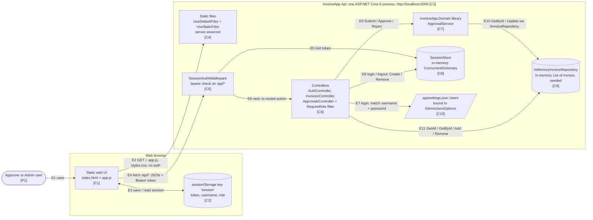
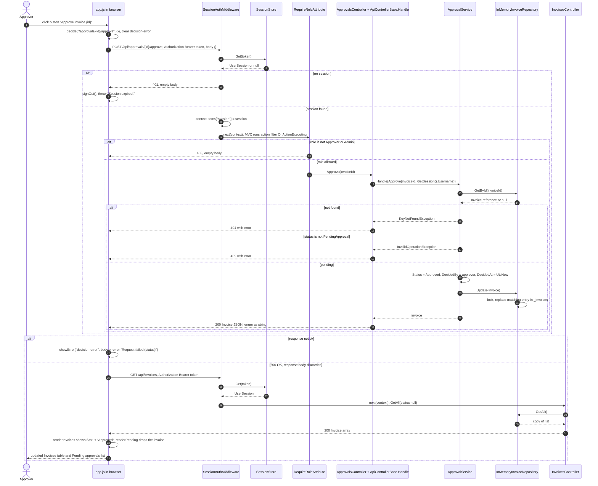

I've made both diagrams and rendered each one with the Mermaid MCP using `svg` output only, so nothing went to mermaid.ink. Both rendered without errors. The SVG output was too large to show inline, so the tool saved it to local files. I searched those files: there's no syntax-error graphic (the only "error" matches are Mermaid's built-in stylesheet), the expected labels are present, and the sequence diagram has its numbered steps. I didn't write any files to the repo.

## 1. Container view

Paths are relative to `backend/src/`. `Api/` means `InvoiceApp.Api/` and `Domain/` means `InvoiceApp.Domain/`.

| ID | Citation |
|---|---|
| P1 | `Api/appsettings.json:9-12` (the only users: Approver, Admin); `Api/Controllers/ApprovalsController.cs:9` |
| C1 | `Api/wwwroot/index.html` (`:74` loads `app.js`); `Api/wwwroot/app.js` |
| C2 | `app.js:4` (read), `app.js:108` (write), `app.js:95` (remove) |
| C3 | `Api/Program.cs:6-24`; `Api/InvoiceApp.Api.csproj:1,3` (Sdk.Web, net8.0); `Api/Properties/launchSettings.json:6` |
| C4 | `Program.cs:19-20` |
| C5 | `Program.cs:21`; `SessionAuthMiddleware.InvokeAsync`, `Api/Auth/SessionAuthMiddleware.cs:16-37` |
| C6 | `Program.cs:9,22`; `AuthController`, `InvoicesController`, `ApprovalsController`; `ApiControllerBase.Handle` (`ApiControllerBase.cs:9`); `RequireRoleAttribute` (`Api/Auth/RequireRoleAttribute.cs:8,17-25`) |
| C7 | `Program.cs:15` (`AddScoped<ApprovalService>`); `Domain/ApprovalService.cs`; `InvoiceApp.Api.csproj:8` (project reference) |
| C8 | `Program.cs:13` (singleton); `Api/Auth/SessionStore.cs:9` |
| C9 | `Program.cs:14` (singleton, bound to `IInvoiceRepository`); `Api/InMemoryInvoiceRepository.cs:6,11-18` |
| C10 | `Program.cs:12`; `appsettings.json:9-12`; `DemoUsersOptions` in `Api/Auth/UserSession.cs:12-15` |
| E1 | `app.js:68,72` (Approve button), `app.js:99` (login form); `index.html:21-28,40-48` |
| E2 | `Program.cs:19-21` (static files come before the auth middleware); `index.html:7,74`; `SessionAuthMiddleware.cs:19` (only `/api` needs a session) |
| E3 | `app.js:4,95,108` |
| E4 | `api()` in `app.js:16-19` |
| E5 | `SessionAuthMiddleware.cs:25` calls `SessionStore.Get` (`SessionStore.cs:18-19`) |
| E6 | `SessionAuthMiddleware.cs:33,36`; `Program.cs:22` |
| E7 | `AuthController.Login`, `AuthController.cs:26-27` (options injected at `:14-16`) |
| E8 | `AuthController.cs:34,44` calls `SessionStore.Create` / `Remove` (`SessionStore.cs:11-16,21`) |
| E9 | `InvoicesController.cs:70`; `ApprovalsController.cs:23,27` |
| E10 | `ApprovalService.cs:27,39,57,62`; `Domain/IInvoiceRepository.cs:5-10`; `Program.cs:14` |
| E11 | `InvoicesController.cs:25,43,60,75` |

## 2. Sequence diagram: approval path

Step numbers match the numbers `autonumber` draws on the diagram.

| Element / step | Citation |
|---|---|
| Participants | `app.js`; `SessionAuthMiddleware.cs:4`; `SessionStore.cs:7`; `RequireRoleAttribute.cs:8`; `ApprovalsController.cs:10` + `ApiControllerBase.cs:6`; `ApprovalService.cs:7`; `InMemoryInvoiceRepository.cs:6`; `InvoicesController.cs:9` |
| 1 | `app.js:68` (button labelled `Approve invoice ${invoice.id}`), `app.js:72` |
| 2 | `app.js:72`, `decide()` at `app.js:82-83` |
| 3 | `app.js:85`, then `api()` at `app.js:17-19`; route from `ApprovalsController.cs:8,21` |
| 4 | `SessionAuthMiddleware.cs:19,23-25` |
| 5 | `SessionStore.cs:18-19` |
| 6 | `SessionAuthMiddleware.cs:27-31` |
| 7 | `app.js:20` |
| 8 | `SessionAuthMiddleware.cs:33` |
| 9 | `SessionAuthMiddleware.cs:36`; `RequireRoleAttribute.cs:17-19`; `ApprovalsController.cs:9` |
| 10 | `RequireRoleAttribute.cs:21-24` |
| 11 | `ApprovalsController.cs:21-22` |
| 12 | `ApprovalsController.cs:23`; `ApiControllerBase.cs:9-13`; `HttpContextExtensions.GetSession` at `SessionAuthMiddleware.cs:44-45` |
| 13 | `ApprovalService.cs:33,61-62` |
| 14 | `InMemoryInvoiceRepository.cs:25-28` |
| 15 | `ApprovalService.cs:63` |
| 16 | `ApiControllerBase.cs:15-18` |
| 17 | `ApprovalService.cs:34,65-71` |
| 18 | `ApiControllerBase.cs:19-22` |
| 19 | `ApprovalService.cs:36-38` |
| 20 | `ApprovalService.cs:39` |
| 21 | `InMemoryInvoiceRepository.cs:50-57` |
| 22 | `ApprovalService.cs:40` |
| 23 | `ApiControllerBase.cs:13`; `Program.cs:10` (`JsonStringEnumConverter`) |
| 24 | `app.js:21-22` (throws), `app.js:87-88` (catches); `index.html:69` |
| 25 | `app.js:86` calls `refresh()` (`app.js:40-41`); `InvoicesController.cs:22-23` |
| 26–27 | `SessionAuthMiddleware.cs:25`; `SessionStore.cs:18-19` |
| 28 | `SessionAuthMiddleware.cs:36`; `InvoicesController.cs:22-23` (the class has no `RequireRole`, `:7-9`) |
| 29 | `InvoicesController.cs:25` |
| 30 | `InMemoryInvoiceRepository.cs:20-23` (`ToList()`) |
| 31 | `InvoicesController.cs:37` |
| 32 | `app.js:42-43` (pending filter), `app.js:59` (status cell), `app.js:64-66` |
| 33 | `index.html:50-62` (table), `index.html:65-70` (pending list) |

**Read directly, but worth knowing:** "shown" means only the status changes. `app.js:85` throws away the approve response. The table shows only id, customer, amount and status (`app.js:56-60`). I searched `wwwroot/` and found no reference to `decidedBy`, `decidedAt` or `decisionNote`, so the UI never shows who approved or when.

## What I inferred rather than read

1. **Route matching and filter placement.** `Program.cs` never calls `UseRouting`. My claim that route matching happens before `SessionAuthMiddleware`, and that `RequireRole` runs inside the MVC filter pipeline, comes from my knowledge of ASP.NET Core 8, not this repo. Arrow 9 (`MW->>RR`) simplifies the endpoint middleware and filter pipeline into one step.
2. **camelCase JSON.** `app.js` reads `invoice.status`, `customerName` and `result.token`, which only works with the framework's default camelCase naming. The repo configures only the enum converter (`Program.cs:10`).
3. **Static files served without sign-in, and "/" serving `index.html`.** I based this on middleware order plus how `UseDefaultFiles`/`UseStaticFiles` normally behave.
4. **The 403 branch can't happen with the shipped config.** Only Approver and Admin users exist (`appsettings.json:9-12`), and both are allowed. Other config sources, like environment variables, could add users.
5. **"Stored" means process memory, on a single instance.** Approvals are lost on restart, and running more than one instance would give each its own data. I inferred this from the singleton `List<Invoice>` and the lack of any persistence code. Nothing in the code describes how the app is deployed.
6. **The stored object changes before `Update` is called.** `GetById` returns the live list element (`InMemoryInvoiceRepository.cs:27`), so lines 36-38 of `ApprovalService.cs` change the stored invoice directly. `Update` then swaps it for itself.
7. **Possible race condition.** `Find`, `EnsurePending` and the field changes run outside the repository lock, so two approvers acting on the same invoice at once could both pass the pending check, and the last write wins. I didn't test this.
8. **False error after a successful approval.** If the refresh GET fails after the approval succeeds, the `catch` at `app.js:87-88` shows an error even though the approval was stored.
9. **401 error message is never seen.** On a 401, `signOut()` hides `app-view`, so the "Session expired." message lands in `decision-error`, which sits inside `app-view` (`index.html:31,69`).
10. **Unexpected exceptions return 500.** Any exception other than the three `Handle` catches falls through to ASP.NET Core's default 500 (framework knowledge).
11. **The UI runs in a browser.** The "Web browser" boundary and how `sessionStorage` behaves per tab come from browser knowledge. Port 5000 applies only when the app runs through the `launchSettings.json` profile.

## Deliberately left out

- **`ops/`:** `AGENTS.md` says it describes a *planned* deployment (database, message topic, payment provider), and none of that exists in the code. I didn't use it.
- **`docs/use-cases` (bulk and partial approval):** I didn't read these briefs. No controller has a bulk or partial endpoint. `IInvoiceRepository.GetByIds` is implemented but nothing in `src/` calls it.
- **`DiscountCalculator`:** nothing calls it.
- **Tests, CI, `e2e/` and `.mcp.json`:** none of these run as part of the app. `e2e/tests/` contains only `.gitkeep`.