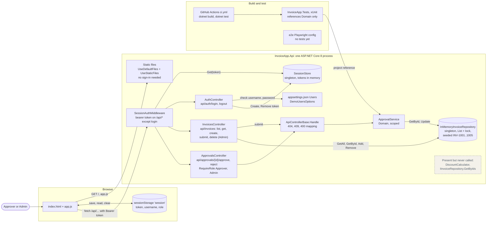
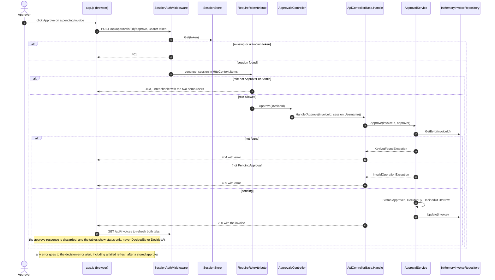

# As-built: the Invoice Approval service as the code stands

This describes upstream `0616158` (imported here as `7f877cc`), the code as committed, not the production system in `ops/`. Nothing here talks to a database, PayEx or Service Bus, because none of them exist in the code.

## How these diagrams were made

1. **Agent draft.** Claude Code (`claude-opus-5-5`) drew both diagrams with the Mermaid MCP (`mcp-mermaid` 0.4.1, local SVG output only). It worked from a clean checkout of `7f877cc`, with `AGENTS.md` as its only instructions. The prompt, the full session and its answer are in [agent-sessions/01-mermaid](../agent-sessions/01-mermaid/): 34 turns, 2 render calls, $0.65.
   - A first run in my working tree could see my own draft diagrams, so I set it aside ([discarded-run-saw-drafts](../agent-sessions/01-mermaid/discarded-run-saw-drafts/)) and re-ran on the clean checkout.
2. **Its citations.** [`check_agent_citations.py`](check_agent_citations.py) resolves every file and line it cited: 107 of 107 ([output](agent-citation-check.txt)).
3. **Its claims.** After its run I drove the approval path against the running app with `curl` ([walkthrough](approval-path-walkthrough.txt)).
4. **The diagrams below** are the corrected versions: its correct additions kept, the issues further down fixed, and all 69 citations re-checked by [`check_citations.py`](check_citations.py). Rendered SVGs are in [diagrams/](diagrams/).

## Container view

| Ref | Element or arrow | Location | Symbol |
| --- | --- | --- | --- |
| C1 | Approver or Admin (the only roles configured) | `backend/src/InvoiceApp.Api/appsettings.json:10-11` | `"Role": "Approver"` |
| C2 | Users act through the page | `backend/src/InvoiceApp.Api/wwwroot/index.html:21` | `<form id="login-form">` |
| C3 | Browser page | `backend/src/InvoiceApp.Api/wwwroot/index.html:6` | `<title>Invoice Approvals</title>` |
| C4 | Script calls the API | `backend/src/InvoiceApp.Api/wwwroot/app.js:19` | `await fetch(` |
| C5 | Token kept in sessionStorage | `backend/src/InvoiceApp.Api/wwwroot/app.js:108` | `sessionStorage.setItem('session'` |
| C6 | One ASP.NET Core 8 process | `backend/src/InvoiceApp.Api/InvoiceApp.Api.csproj:1-3` | `net8.0` |
| C7 | Static files served | `backend/src/InvoiceApp.Api/Program.cs:19-20` | `app.UseStaticFiles();` |
| C8 | Session middleware in the pipeline | `backend/src/InvoiceApp.Api/Program.cs:21` | `UseMiddleware<SessionAuthMiddleware>` |
| C9 | Token required on /api except login | `backend/src/InvoiceApp.Api/Auth/SessionAuthMiddleware.cs:19` | `!path.StartsWithSegments("/api/auth/login")` |
| C10 | Controllers mapped | `backend/src/InvoiceApp.Api/Program.cs:22` | `app.MapControllers();` |
| C11 | AuthController route | `backend/src/InvoiceApp.Api/Controllers/AuthController.cs:8` | `[Route("api/auth")]` |
| C12 | InvoicesController route | `backend/src/InvoiceApp.Api/Controllers/InvoicesController.cs:8` | `[Route("api/[controller]")]` |
| C13 | Delete is Admin only | `backend/src/InvoiceApp.Api/Controllers/InvoicesController.cs:72-73` | `[RequireRole("Admin")]` |
| C14 | ApprovalsController roles | `backend/src/InvoiceApp.Api/Controllers/ApprovalsController.cs:9` | `[RequireRole("Approver", "Admin")]` |
| C15 | Approve route | `backend/src/InvoiceApp.Api/Controllers/ApprovalsController.cs:21` | `[HttpPost("{invoiceId}/approve")]` |
| C16 | Reject route | `backend/src/InvoiceApp.Api/Controllers/ApprovalsController.cs:25` | `[HttpPost("{invoiceId}/reject")]` |
| C17 | Handle maps errors | `backend/src/InvoiceApp.Api/Controllers/ApiControllerBase.cs:9` | `protected ActionResult<Invoice> Handle(Func<Invoice> action)` |
| C18 | ApprovalService is scoped | `backend/src/InvoiceApp.Api/Program.cs:15` | `AddScoped<ApprovalService>()` |
| C19 | Repository is a singleton | `backend/src/InvoiceApp.Api/Program.cs:14` | `AddSingleton<IInvoiceRepository, InMemoryInvoiceRepository>()` |
| C20 | Repository locks a list | `backend/src/InvoiceApp.Api/InMemoryInvoiceRepository.cs:8` | `private readonly object _lock = new();` |
| C21 | Seed data | `backend/src/InvoiceApp.Api/InMemoryInvoiceRepository.cs:13` | `INV-1001` |
| C22 | SessionStore is a singleton | `backend/src/InvoiceApp.Api/Program.cs:13` | `AddSingleton<SessionStore>()` |
| C23 | Tokens held in memory | `backend/src/InvoiceApp.Api/Auth/SessionStore.cs:9` | `ConcurrentDictionary<string, UserSession>` |
| C24 | Users come from configuration | `backend/src/InvoiceApp.Api/appsettings.json:9` | `"Users"` |
| C25 | Users bound to options | `backend/src/InvoiceApp.Api/Program.cs:12` | `Configure<DemoUsersOptions>` |
| C26 | DiscountCalculator exists | `backend/src/InvoiceApp.Domain/DiscountCalculator.cs:4` | `public class DiscountCalculator` |
| C27 | GetByIds declared | `backend/src/InvoiceApp.Domain/IInvoiceRepository.cs:7` | `GetByIds` |
| C28 | GET / serves index.html | `backend/src/InvoiceApp.Api/Program.cs:19` | `app.UseDefaultFiles();` |
| C29 | Session read on start | `backend/src/InvoiceApp.Api/wwwroot/app.js:4` | `sessionStorage.getItem('session')` |
| C30 | Session cleared on sign-out | `backend/src/InvoiceApp.Api/wwwroot/app.js:95` | `sessionStorage.removeItem('session');` |
| C31 | Bearer token on every call | `backend/src/InvoiceApp.Api/wwwroot/app.js:18` | `headers.Authorization` |
| C32 | Middleware looks up the token | `backend/src/InvoiceApp.Api/Auth/SessionAuthMiddleware.cs:25` | `_sessions.Get(token)` |
| C33 | Login checks configured users | `backend/src/InvoiceApp.Api/Controllers/AuthController.cs:26-27` | `u.Password == request.Password` |
| C34 | Login creates a token | `backend/src/InvoiceApp.Api/Controllers/AuthController.cs:34` | `_sessions.Create(` |
| C35 | Logout removes the token | `backend/src/InvoiceApp.Api/Controllers/AuthController.cs:44` | `_sessions.Remove(` |
| C36 | Approve goes through Handle | `backend/src/InvoiceApp.Api/Controllers/ApprovalsController.cs:23` | `Handle(() => _approvals.Approve(` |
| C37 | Submit goes through Handle | `backend/src/InvoiceApp.Api/Controllers/InvoicesController.cs:70` | `Handle(() => _approvals.Submit(id))` |
| C38 | Invoices list reads the repository | `backend/src/InvoiceApp.Api/Controllers/InvoicesController.cs:25` | `_repository.GetAll()` |
| C39 | Get by id reads the repository | `backend/src/InvoiceApp.Api/Controllers/InvoicesController.cs:43` | `_repository.GetById(id)` |
| C40 | Create writes the repository | `backend/src/InvoiceApp.Api/Controllers/InvoicesController.cs:60` | `_repository.Add(` |
| C41 | Delete removes from the repository | `backend/src/InvoiceApp.Api/Controllers/InvoicesController.cs:75` | `_repository.Remove(id)` |
| C42 | Service reads the invoice | `backend/src/InvoiceApp.Domain/ApprovalService.cs:62` | `_repository.GetById(invoiceId)` |
| C43 | Service saves the invoice | `backend/src/InvoiceApp.Domain/ApprovalService.cs:39` | `_repository.Update(invoice);` |
| C44 | CI builds and tests | `.github/workflows/ci.yml:17-18` | `dotnet test backend/InvoiceApp.sln` |
| C45 | Tests reference Domain only | `backend/tests/InvoiceApp.Tests/InvoiceApp.Tests.csproj:15` | `InvoiceApp.Domain.csproj` |
| C46 | e2e has config, no tests | `e2e/playwright.config.ts:4` | `testDir: './tests'` |

## Sequence: approving an invoice

| Ref | Element or arrow | Location | Symbol |
| --- | --- | --- | --- |
| S1 | Approver clicks Approve | `backend/src/InvoiceApp.Api/wwwroot/app.js:72` | `approve.addEventListener('click'` |
| S2 | decide() posts to the approve route | `backend/src/InvoiceApp.Api/wwwroot/app.js:85` | `await api(path, { method: 'POST'` |
| S3 | Middleware looks up the token | `backend/src/InvoiceApp.Api/Auth/SessionAuthMiddleware.cs:25` | `_sessions.Get(token)` |
| S4 | 401 when there is no session | `backend/src/InvoiceApp.Api/Auth/SessionAuthMiddleware.cs:29` | `Status401Unauthorized` |
| S5 | Session stored for the request | `backend/src/InvoiceApp.Api/Auth/SessionAuthMiddleware.cs:33` | `context.Items[HttpContextExtensions.SessionKey] = session;` |
| S6 | 403 when the role is not listed | `backend/src/InvoiceApp.Api/Auth/RequireRoleAttribute.cs:21-23` | `Status403Forbidden` |
| S7 | Controller action | `backend/src/InvoiceApp.Api/Controllers/ApprovalsController.cs:22` | `public ActionResult<Invoice> Approve(string invoiceId)` |
| S8 | Approver name from the session | `backend/src/InvoiceApp.Api/Controllers/ApprovalsController.cs:23` | `HttpContext.GetSession().Username` |
| S9 | Service Approve | `backend/src/InvoiceApp.Domain/ApprovalService.cs:31` | `public Invoice Approve(string invoiceId, string approver)` |
| S10 | Invoice looked up | `backend/src/InvoiceApp.Domain/ApprovalService.cs:62` | `_repository.GetById(invoiceId)` |
| S11 | Not found throws | `backend/src/InvoiceApp.Domain/ApprovalService.cs:63` | `KeyNotFoundException` |
| S12 | Mapped to 404 | `backend/src/InvoiceApp.Api/Controllers/ApiControllerBase.cs:17` | `return NotFound(` |
| S13 | Not pending throws | `backend/src/InvoiceApp.Domain/ApprovalService.cs:67-69` | `InvalidOperationException` |
| S14 | Mapped to 409 | `backend/src/InvoiceApp.Api/Controllers/ApiControllerBase.cs:21` | `return Conflict(` |
| S15 | Decision fields set | `backend/src/InvoiceApp.Domain/ApprovalService.cs:36-38` | `invoice.DecidedAt = DateTime.UtcNow;` |
| S16 | Invoice saved | `backend/src/InvoiceApp.Domain/ApprovalService.cs:39` | `_repository.Update(invoice);` |
| S17 | 200 with the invoice | `backend/src/InvoiceApp.Api/Controllers/ApiControllerBase.cs:13` | `return Ok(action());` |
| S18 | UI refreshes | `backend/src/InvoiceApp.Api/wwwroot/app.js:86` | `await refresh();` |
| S19 | Refresh reloads all invoices | `backend/src/InvoiceApp.Api/wwwroot/app.js:41` | `await api('/invoices')` |
| S20 | Approve response not used | `backend/src/InvoiceApp.Api/wwwroot/app.js:85` | `body: JSON.stringify(payload) });` |
| S21 | Tables show status, not the decider | `backend/src/InvoiceApp.Api/wwwroot/app.js:56-60` | `money.format(invoice.amount)` |
| S22 | Errors shown in the alert | `backend/src/InvoiceApp.Api/wwwroot/app.js:88` | `showError('decision-error', error.message);` |
| S23 | Status serialised as text | `backend/src/InvoiceApp.Api/Program.cs:10` | `JsonStringEnumConverter` |

## What the agent inferred

| # | Its inference, shortened | My verdict | Evidence |
| --- | --- | --- | --- |
| 1 | Routing runs before `SessionAuthMiddleware`, and `RequireRole` runs in the MVC filter pipeline | Right; framework behaviour | 401 comes before any 403 or 404 in the walkthrough |
| 2 | JSON is camelCase | Confirmed | Walkthrough shows `"customerName"`, `"status":"Approved"` |
| 3 | Static files need no sign-in, and `/` serves `index.html` | Confirmed | `GET /` returns 200 with no token |
| 4 | The 403 branch cannot happen with the shipped users | Confirmed | `demo.admin` approve returns 200 |
| 5 | "Stored" means process memory, on one instance | Confirmed in part | Data survives sign-out and resets only on restart; more than one instance can't be tested here |
| 6 | The stored object changes before `Update` runs | Right | `InMemoryInvoiceRepository.cs:27` returns the list element itself |
| 7 | Two concurrent approvals can both pass `EnsurePending` | Right, not tested | `ApprovalService.cs:33-39` runs outside the repository lock |
| 8 | A failed refresh shows an error after a stored approval | Right | `app.js:85-88` |
| 9 | "Session expired." can never be seen | Right | `app.js:20` signs out, which hides `app-view`, the container of `decision-error` (`index.html:31,69`) |
| 10 | Other exceptions become a 500 | Right; framework default | n/a |
| 11 | Port 5000 applies only through the launch profile | **Wrong** | Kestrel also listens on `http://localhost:5000` when nothing sets a URL. The walkthrough starts the app with no profile and no URL, and it logs exactly that. |

## What I changed in its draft, and why

1. **The listening address drawn as part of the process.** Its container labels the host "http://localhost:5000". That is environment configuration, not something this code sets. Locally it comes from the launch profile or Kestrel's default (its inference 11 gets the reason wrong); on App Service the platform assigns the port. I removed it.
2. **Three controllers merged into one box.** That hid a difference that matters for security:
   - `ApprovalsController` requires Approver or Admin on every action.
   - `InvoicesController` restricts only Delete to Admin, so any signed-in user can create and submit invoices.
   - `AuthController` has no role check.

   I drew them separately, with `ApiControllerBase.Handle` as the error-mapping step that approvals and submit share.
3. **No build boundary.** Its view stops at the runtime. I added the CI workflow and the test project. The only automated check in this repository is part of how the system is built, and the test project referencing Domain alone is what makes the architecture test possible.

It drew nothing that does not exist: no invented component, no system from `ops/` drawn as real, no wrong route. Its session shows why. It read the `AGENTS.md` warning about `ops/` and kept to it. Its one factual error is inference 11.

## What it found that I had missed

- The browser keeps the session token in `sessionStorage` (`app.js:4,95,108`).
- The UI throws away the approve response and never shows who approved or when. The tables show id, customer, amount and status only (`app.js:56-60`). For a service facing a SOC 2 audit, that matters.
- `DiscountCalculator` and `IInvoiceRepository.GetByIds` exist, but nothing calls them.
- A failed refresh after a stored approval shows an error, and "Session expired." can never be seen.

## Where the code departs from AGENTS.md

- **Business rules in a controller:** `InvoicesController.Create` validates the customer name and the amount itself (`InvoicesController.cs:50-58`).
- **Wrong base class:** `AuthController` inherits `ControllerBase`, not `ApiControllerBase` (`AuthController.cs:9`).
- **Repository used directly:** `InvoicesController` calls the repository for list, get, create and delete (`InvoicesController.cs:25,43,60,75`).

## Other risks before production

- Sessions never expire. The demo accounts and their plain-text passwords in `appsettings.json` are fine for a demo (AGENTS.md calls them "not real credentials") but cannot ship.
- Nothing in the UI shows who approved an invoice or when.

## How the diagrams were checked

- [`check_citations.py`](check_citations.py) opens every cited file and confirms the symbol sits within a line of the cited line. Run it with `python3 docs/architecture/check_citations.py`; the result is at the end of [approval-path-walkthrough.txt](approval-path-walkthrough.txt).
- I ran the app with no launch profile and no URL, and drove the approval path with `curl` ([approval-path-walkthrough.txt](approval-path-walkthrough.txt)):
  - **Without auth:** `GET /` returns 200; any `/api` call returns 401.
  - **Decisions:** approve returns 200, a second approve 409, an unknown invoice 404, and a blank reject reason 400.
  - **Admin:** `demo.admin` also gets 200, so no configured user can reach the 403 branch.
  - **Ops route:** `POST /api/invoices/{id}/approve`, the route the INC-2041 logs show, is a 404 here. Those logs describe the planned system, not this code.
- All four diagrams render through the Mermaid MCP ([`render_diagrams.py`](render_diagrams.py)).
