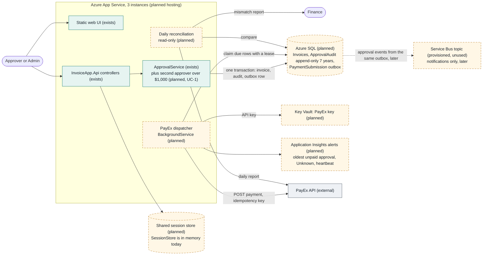
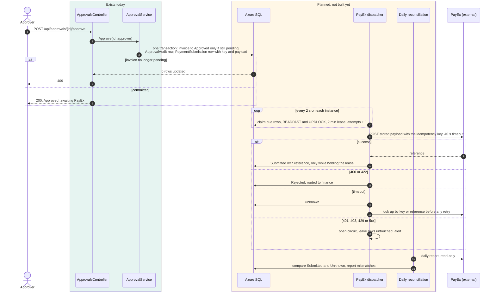

# Target state: once persistence and PayEx are in

This is the service after the January work, following [ADR-001](../adr/ADR-001-exactly-once-payex-submission.md). **Green boxes exist in the code today. Dashed amber boxes do not exist yet.** Grey is external.

## Container view

| Element | Status | Source |
| --- | --- | --- |
| Static web UI | Exists | `backend/src/InvoiceApp.Api/wwwroot/` |
| API controllers and sign-in | Exists. Demo users come from `appsettings.json`, which is not fit for production. | `backend/src/InvoiceApp.Api/Controllers/`, `Auth/` |
| ApprovalService | Exists. It gains the second-approver rule for invoices over $1,000 (UC-1), and writes the outbox row on final approval. | `backend/src/InvoiceApp.Domain/ApprovalService.cs` |
| App Service, 3 instances | **Planned** | Scenario facts, `ops/incidents/INC-2041/README.md` |
| Azure SQL: Invoices, ApprovalAudit, PaymentSubmission | **Planned**. Today the store is an in-memory list. | ADR-001, decision step 1 |
| PayEx dispatcher | **Planned** | ADR-001, steps 3 to 6 |
| Daily reconciliation | **Planned** | ADR-001, step 7 |
| Shared session store | **Planned**. `SessionStore` keeps tokens in process memory, which breaks with three instances. | ADR-001, consequences |
| Key Vault for the PayEx key | **Planned**. The key was rotated on 23 January, so it must change without a deploy. | ADR-001, cost |
| Application Insights alerts | **Planned** | ADR-001, step 8 |
| Service Bus topic | Provisioned, unused. Later it carries notifications from the same outbox. Never in the payment path. | ADR-001, decision |
| PayEx | External | Scenario facts |

## Sequence: approving an invoice

## What changes compared with today

- The approve request no longer does anything external. It commits one transaction and returns, so a slow or broken PayEx cannot slow approvals (INC-2041).
- "Only pending invoices can be decided" moves from an in-memory check (`EnsurePending`) to a conditional update in SQL. That makes it hold across three instances and concurrent clicks.
- Every payment attempt reuses one stored key and one stored payload. The dispatcher claims rows with a lease, so two instances never send the same row at once.
- Alerts watch outcomes (the oldest unpaid approval), not just whether the process is running. That is the lesson of INC-2047.

Not shown here: the notification worker from INC-2047 and UC-2 partial approval. Neither changes this path, except that the payload carries the approved amount.
